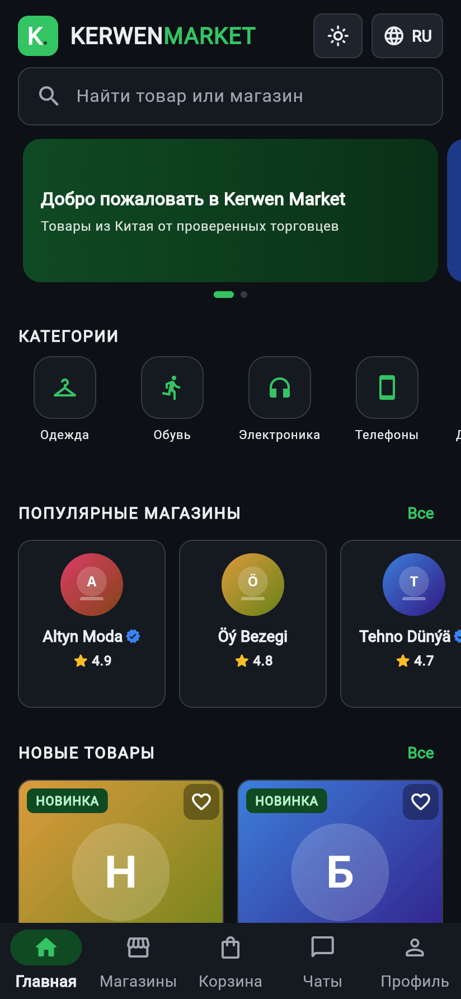
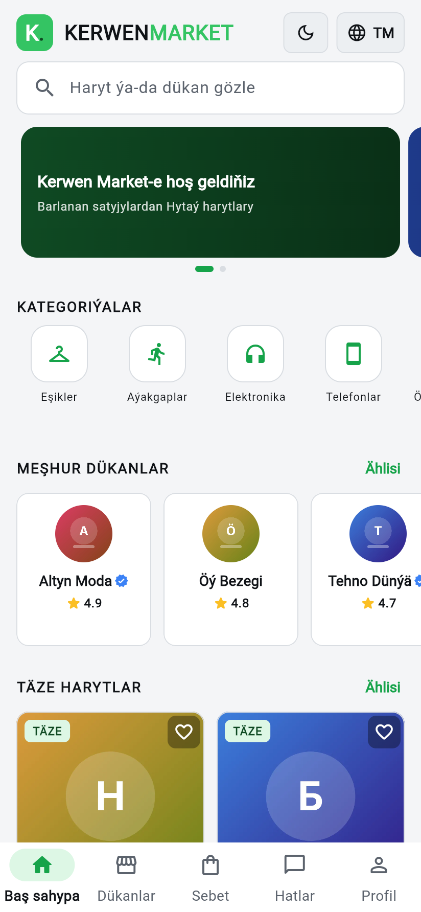
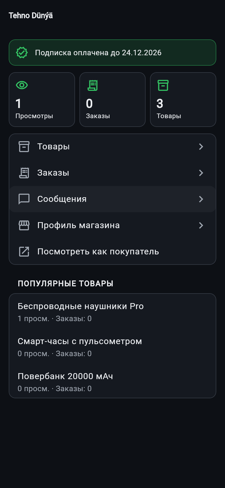
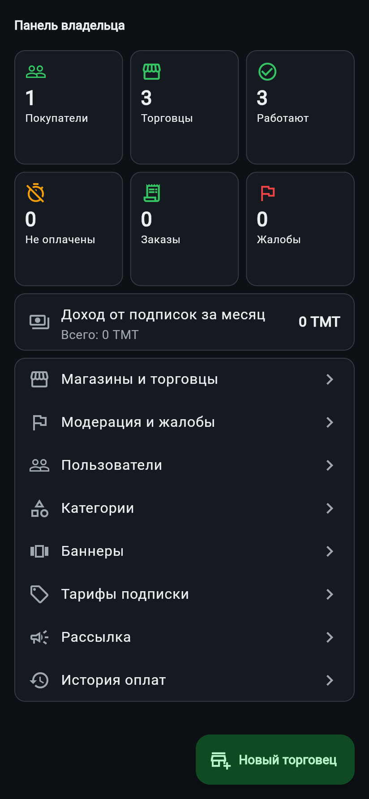

# Kerwen Market

Маркетплейс «торговый центр» для Туркменистана: торговцы (товары из Китая) получают свой магазин
в приложении, покупатели заказывают и общаются с продавцом в чате. Торговцы платят владельцу
ежемесячную подписку в TMT.

<p>




</p>

## Что внутри

| Папка | Что это |
|---|---|
| `app/` | Мобильное приложение (Flutter: Android + iOS), русский и туркменский, тёмная/светлая тема |
| `server/` | Сервер API (Node.js 22, NestJS, PostgreSQL), WebSocket для чата |
| `deploy/` | Запуск на сервере: Docker, HTTPS (Caddy), резервные копии |
| `docs/` | Инструкции: [запуск](docs/DEPLOY.md), [решения](docs/DECISIONS.md), [безопасность](docs/SECURITY.md), [вопросы юристу](docs/LEGAL_TODO.md) |
| `CLAUDE.md` | Главное ТЗ проекта |

## Возможности

- **Покупатель:** вход через Google или телефон+пароль, главная (баннеры, категории, магазины, новинки),
  поиск и фильтры (категория, цена, сортировка), магазины, товар с фото/видео и вариантами,
  корзина (заказ — отдельно в каждом магазине), статусы заказа, отзывы, избранное, жалобы, уведомления.
- **Чат:** текст, фото, видео, голосовые; «печатает…», доставлено/прочитано; отправка без дублей при плохой сети.
- **Торговец:** код от владельца → свой магазин; товары (фото, видео, варианты, остатки, скрыть/удалить),
  заказы со сменой статуса, сообщения, статистика, напоминание о подписке за 5 дней.
- **Владелец:** статистика и доход, создание торговцев с кодом приглашения, приём оплат, блокировки,
  проверенный продавец, модерация жалоб, категории, баннеры, тарифы, рассылки, история действий.

## Разработка (для программиста)

```bash
# сервер
cd server && npm ci
cp .env.example .env   # указать DATABASE_URL и секреты
npm run build:all && npm run db:migrate && node dist/src/db/seed.js --demo
npm start               # http://localhost:3000/health
npm test                # нужен PostgreSQL, TEST_DATABASE_URL

# приложение
cd app && flutter pub get
flutter run --dart-define=API_URLS=http://10.0.2.2:3000   # эмулятор Android
flutter test && flutter analyze
```

CI (GitHub Actions) на каждом push: тесты сервера, анализ и тесты приложения, сборка APK.
