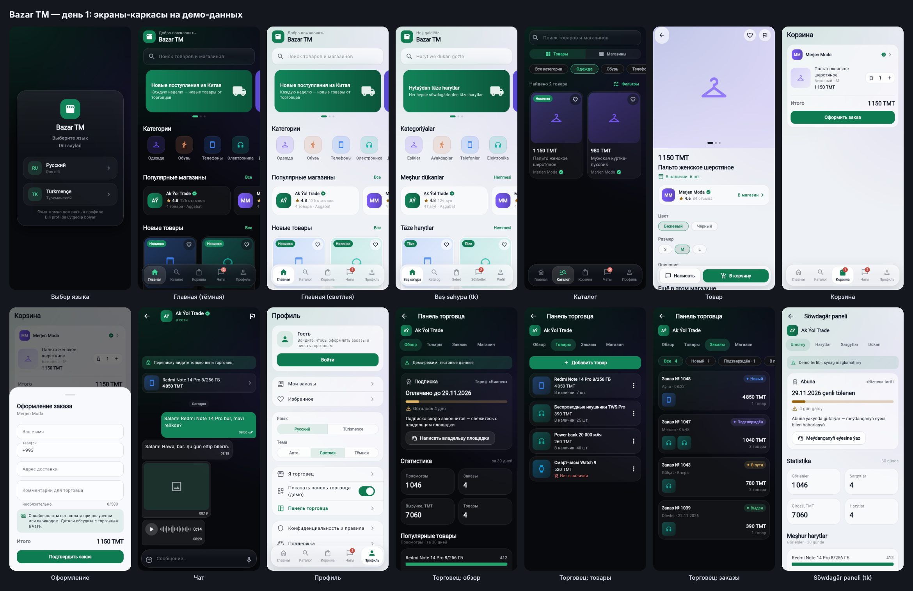

# Bazar TM (рабочее название)

Маркетплейс-«торговый центр» для торговцев Туркменистана: у каждого торговца свой магазин
и своя панель, покупатели заказывают и пишут торговцу в чате. Полное ТЗ — в [CLAUDE.md](CLAUDE.md).



## Что сейчас готово (день 1 из 9)

- **Приложение на телефон (Flutter):** все основные экраны-каркасы работают на демо-данных:
  - главная, каталог, магазин, товар;
  - корзина и оформление заказа;
  - мои заказы, чаты, профиль, вход;
  - панель торговца: обзор, товары, заказы, профиль магазина.
- **Языки:** русский и туркменский. Язык выбирают при первом запуске, поменять его можно в профиле.
- **Темы:** светлая, тёмная и «Авто» (как в телефоне).
- **Дизайн-система:** цвета, шрифты, отступы, анимации и компоненты описаны в [docs/DESIGN.md](docs/DESIGN.md).
- **Сервер (Node.js + NestJS):** только каркас и проверка «сервер жив». База данных, вход и
  остальное — со дня 2.

**Важно: это демо.** Данные не сохраняются на сервере. После перезапуска приложения корзина и
заказы пустые, а выбранные язык и тема сохраняются. Вход, фото, голосовые и отправка жалоб
показывают «Скоро будет доступно» — они появятся в следующие дни (план в [docs/PLAN.md](docs/PLAN.md)).

## Как проверить на телефоне (Android)

1. Скачайте тестовую сборку:
   <https://github.com/atasmerdanow910-cloud/chess-sitw/releases/download/bazar-tm-test/bazar-tm.apk>
   (лёгкая версия для большинства телефонов:
   <https://github.com/atasmerdanow910-cloud/chess-sitw/releases/download/bazar-tm-test/bazar-tm-arm64.apk>).
2. Откройте файл и разрешите установку из этого источника.
3. Что попробовать:
   - выбрать язык;
   - найти товар в каталоге и положить его в корзину;
   - оформить заказ (номер телефона +993…);
   - в «Профиле» включить «Показать панель торговца (демо)» и увидеть свой заказ у торговца;
   - сменить статус заказа и добавить товар.

Сборку делает GitHub автоматически после каждого изменения. Если телефон пишет «приложение не
установлено», удалите старую тестовую версию и установите заново.

## Структура

```
bazar-tm/
├── CLAUDE.md            ТЗ проекта
├── app/                 приложение Flutter (Android + iOS)
│   ├── lib/core/        тема, цвета, форматы денег и дат, настройки
│   ├── lib/data/        модели, демо-данные, хранилища (корзина, заказы, чаты)
│   ├── lib/features/    экраны по разделам
│   ├── lib/l10n/        тексты: app_ru.arb и app_tk.arb
│   └── test/            тесты
├── server/              сервер NestJS (TypeScript)
├── docker-compose.yml   PostgreSQL + Redis + сервер (для дня 2+)
└── docs/                план, дизайн, юридические вопросы, скриншоты
```

Папка `app/web` нужна только разработчику: для быстрых скриншотов и проверки дизайна в браузере.
Веб-версию мы не выпускаем — по ТЗ она не входит в версию 1.

## Для разработчика

Приложение (Flutter 3.50):

```bash
cd app
flutter pub get
flutter run              # на подключённом телефоне или эмуляторе
flutter analyze && flutter test
```

Сервер (Node.js 22):

```bash
cd server
npm ci
npm run dev              # http://127.0.0.1:3000/api/v1/health
npm run lint && npm test
```

Секреты (`.env`, ключи подписи) в git не попадают: пример настроек лежит в `.env.example`.
Автопроверка и сборка APK: `.github/workflows/bazar-tm.yml`.
